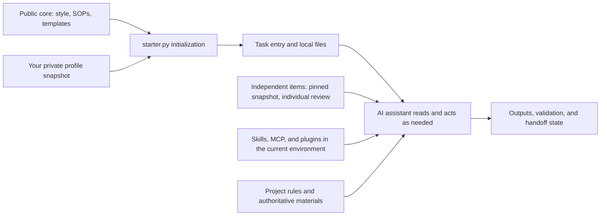

[中文](README.md) | **English**

# Harness: clear rules, evidence, and continuity for AI work

Harness is a local, file-based AI collaboration kit. It records working agreements, task goals, material locations, validation, and handoffs in files you can inspect.
It is useful for research, writing, product planning, and multi-step development, especially when work continues across conversations or reuses existing methods.
Your chosen Codex or other AI assistant performs the work; this repository provides general methods, templates, and management tools that use only the Python standard library.

The approach comes from the author's personal Harness practice: define goals and completion criteria first, read materials as needed, support conclusions with evidence,
leave a next action when interrupted, and review useful experience before turning it into a reusable method. The public package extracts these general practices; personal profiles and project materials are kept separately.

Current source: **0.2.0-rc.9, a source candidate without a published Release**. Requires Python 3.11+.
The latest published distribution is still **0.2.0-rc.4**; this update does not replace its attachments.
rc.8 clarifies required validation, when to stop, recovery order, and reuse of important corrections; rc.9 limits public descriptions to the shipped program and templates. CLI behavior is unchanged apart from version registration.
This English overview links to detailed guides and installed templates that are currently mainly in Chinese.
[Download published rc.4](https://github.com/MarkTian-Long/harness-starter/releases/tag/v0.2.0-rc.4) ·
[Architecture and capability boundaries](docs/architecture.md) · [Validation records](docs/VALIDATION.md)

## What it helps with

| Problem at work | Harness approach | Relevant files |
| --- | --- | --- |
| Repeating working preferences in every new conversation | A short entry point that routes each task to applicable rules and personal adjustments | `AGENTS.md`, `profile/style.md`, `private/` |
| Tasks keep expanding without a clear finish | State the current goal, authoritative inputs, completion criteria, and unfinished items | `task.md`, task workflow SOP |
| Research findings and inference become mixed | Check sources, dates, and direct evidence; preserve unknowns | Research and evidence SOP |
| Files and outputs become scattered | Establish one authoritative location and reference existing project entry points | Storage SOP, `workspace/` |
| Resuming work requires explaining all the context again | Record completed outputs, evidence locations, and the next action | `recovery/checkpoint.md` |
| Changes or new tools are difficult to assess | Define scope, validation, dependencies, and recovery | Change recovery and tool adoption SOPs |
| Accumulated experience becomes duplicated rules | Start with a small candidate; update the authoritative version after trials and review | Closeout and learning SOP |

For example, public-source research can start with the question and completion criteria in `task.md`, organize sources using the research SOP,
and put comparisons and recommendations in the authoritative output location. Leave a checkpoint if interrupted; at closeout, extract only method candidates with reuse value.
These Markdown files are working agreements for the assistant to follow. The Python program checks files and installation state; research quality still needs acceptance.

## Start in five minutes

Download `harness-starter-0.2.0-rc.4.zip` from the [latest published Release](https://github.com/MarkTian-Long/harness-starter/releases/tag/v0.2.0-rc.4),
verify its SHA-256 against the attachment, and extract it.
From the directory containing `starter.py`, initialize a separate empty directory in PowerShell:

```powershell
New-Item -ItemType Directory ../my-harness
python -B starter.py init ../my-harness
python -B starter.py init ../my-harness --apply
python -B starter.py doctor ../my-harness
```

The first `init` previews changes; `--apply` writes them. The target must be a new, already existing empty directory.
The default recommended preset includes collaboration style, six on-demand SOPs, and handoff templates.
For the smallest rule set, add `--preset minimal` to both `init` commands; add `--recovery` when you need a checkpoint.

Give the generated directory to your assistant and start with:

> Read AGENTS.md and FIRST_USE.md in this directory first. Help me record the current goal, inputs, and completion criteria in task.md, then complete the task. Read only applicable SOPs. I will provide personal facts; use the tool permissions available in the current environment. Record the next action if interrupted.

For your first task, choose something small with a clear acceptance check, such as a one-page comparison and recommendation based on three public sources.
Check whether the assistant actually read the rules, whether its result is accurate, and whether work can resume after an interruption.

You can also start from source:

```powershell
git clone https://github.com/MarkTian-Long/harness-starter.git
cd harness-starter
git checkout v0.2.0-rc.4
```

Keep task directories beside the source or extracted package so private materials stay outside the public repository.
GitHub's automatically generated Source code attachments are source snapshots; the ZIP with the versioned name above is the distribution checked against the exact allowlist.

## One core, separate layers

The public core maintains a thin entry point, shared boundaries, and basic SOPs. The independent kit offers Skills, SOPs, templates, diagrams, and small scripts you can choose for a specific task.
Each user maintains their own preferences and profile; tasks and projects keep their own materials and state.
Machine paths, account connections, Skills, and tool permissions belong to the current runtime environment.

| What you need | Where to find it | How to adopt it |
| --- | --- | --- |
| Basic task rules, file lifecycle, and six general SOPs | This public core | Choose a fixed Release or source commit; preview initialization before applying |
| An independent method or small tool for a task | [ai-workflow-kit navigation](https://github.com/MarkTian-Long/ai-workflow-kit) | Select one item; pin its version/commit and retain its dependencies, license, and instructions |
| Your preferences, profile, and machine or project differences | Your private layer and authoritative project entry points | Review and maintain them separately from the public core and independent kit |

The kit entry point checked for this candidate is [fixed snapshot 13db403](https://github.com/MarkTian-Long/ai-workflow-kit/tree/13db4036c359188af37693bb34684c1556da2ffb).
Use `main` to browse and discover updates, rather than as a reproducible adoption identifier. Read SOPs directly; trial each Skill according to its instructions.
Handle the relevant directory and host support when installation is needed. A whole-kit installation or a link alone does not establish adoption.
First check the current authoritative sources and existing local methods; add an item when a real gap calls for it.



| Generated file or directory | Responsibility |
| --- | --- |
| `AGENTS.md` | Thin entry point that routes a task to applicable materials |
| `FIRST_USE.md` | Initial choices, editable content, and the first real task |
| `profile/style.md` | Recommended collaboration style and six analysis lenses; omitted by the minimal preset |
| `standards/` | Six on-demand SOPs; omitted by the minimal preset |
| `private/overlay.md` | Your collaboration preferences; blank template by default |
| `private/profile.md` | Optional personal background and scope; create it yourself or explicitly import it |
| `task.md` | Current goal, inputs, completion criteria, and status |
| `workspace/`, `personal/` | Entry points for project materials and independent personal experiments |
| `recovery/checkpoint.md` | Outputs, unfinished items, evidence locations, and the next action when interrupted |
| `.starter-state.json` | Version, managed files, and initial digests recorded by the program |

Established projects continue to use their own `AGENTS.md`, standards, plans, and status entry points. Reference authoritative materials in place to avoid duplicate ledgers.
The recommended style is an editable default. It includes neither the author's identity nor their historical permissions for external actions.
See [architecture](docs/architecture.md) for responsibilities and data flow, and [modules](docs/modules.md) for preset differences.

## Current capabilities

| Capability | Current status |
| --- | --- |
| Recommended/minimal initialization, preview before writing | Provided by public `starter.py` |
| File checks, handoff entry points, offline example, and preservation on exit | Provided by public `starter.py` |
| Explicit snapshot export/import of your preferences and profile | Provided by public `starter.py`; handles only two private Markdown files |
| Six SOPs, analysis lenses, method candidates, and review agreements | Provided as public Markdown for the assistant to follow as needed |
| Finding existing methods for real tasks, individual trials, and benefit review | Defined by existing entry points and SOPs; no automatic installer or new global registry |
| User-level or global installation | Not provided; initialization affects only the explicitly selected dedicated empty directory |
| Third-party Skills, MCP, plugins, models, and accounts | Use your current environment; their implementations and authentication state are not bundled |
| Automatic two-machine synchronization, conflict merging, automatic method promotion, and a complete memory governance system | Not provided by the current public package |

When combining this package with an existing project or assistant environment, verify the reading entry points, rule conflicts, material ownership, and current authorization.
The package provides no global installer and does not automatically replace existing rules. See [architecture](docs/architecture.md) for the public program and template responsibilities.

## Moving to another computer: export and import your private configuration

Edit `private/overlay.md` and optional `private/profile.md` in an initialized directory.
From a matching version of the core, run:

```powershell
python -B starter.py export-profile ../my-harness --output ../my-profile.json
python -B starter.py export-profile ../my-harness --output ../my-profile.json --apply
```

The output must be a new file outside the target directory. It collects only those two Markdown files, excluding project materials, Skills,
accounts, permissions, chats, and native memories. The JSON is unencrypted; transfer it only through a channel you trust.

Prepare the same core version on the new computer, keep your private JSON beside the package directory, and run:

```powershell
New-Item -ItemType Directory ../my-harness
python -B starter.py init ../my-harness --profile ../my-profile.json
python -B starter.py init ../my-harness --profile ../my-profile.json --apply
python -B starter.py doctor ../my-harness
```

This is an explicitly selected snapshot export/import. When using both computers over time, review their method candidates and preference differences,
then decide what each machine adopts. Projects retain their own materials. The program does not perform two-way synchronization or three-way merging.
After import, verify facts, paths, dependencies, accounts, and authorization; see [migration scope](docs/migration.md).

## Check, resume, and exit

`doctor` checks file usability, installation state, and differences from templates. It does not judge the correctness of the content.
Work can resume after ordinary edits; missing required files, damaged state, or unsafe paths cause failure.
`recover` points to the task and checkpoint when files are usable; it does not restore a complete chat history.

```powershell
python -B starter.py recover ../my-harness
python -B starter.py demo ../my-harness --apply
python -B starter.py uninstall ../my-harness
python -B starter.py uninstall ../my-harness --apply
```

The synthetic `demo` result is `count=3`, `total=10`. It checks the local tool workflow and does not measure AI task quality.
Uninstall removes only unchanged managed public files; it retains private files, modified files, and unregistered files.
It also retains the necessary `.gitignore`, so the directory may remain nonempty.

`rollback` is an alias for uninstall, rather than historical version recovery. Manage installations from other Releases with their matching older scripts.
There is no in-place upgrader in this version: retain the old directory and trial an upgrade in a new empty directory.
Initialization does not change global Codex configuration or create services or background tasks.

## Build, validate, and contribute

From a public source directory whose allowlist and manifest match, run:

```powershell
python -B release.py
python -B tests/acceptance.py
```

This source candidate builds `dist/harness-starter-0.2.0-rc.9.zip` and `dist/release-manifest.json`, which includes the ZIP digest.
Local builds, source commits, and Release attachments are verified separately. A successful build does not mean this candidate's Release has been published.
Acceptance runs the same unit suite in the source and extracted ZIP directories; repeated runs do not count as additional independent cases.
Documentation is part of the exact distribution allowlist. After editing it, increment the candidate version and regenerate the embedded manifest; see [release and recovery](docs/release.md).

GitHub Actions validates public files and the CLI on Windows/Linux with Python 3.11/3.12. It performs acceptance only and does not create a Release.
Check actual results in [public validation notes](docs/VALIDATION.md), [Actions](https://github.com/MarkTian-Long/harness-starter/actions),
and the corresponding Release attachments. Passing file and build checks does not establish automatic rule loading, usability on a second physical computer, or benefits on real tasks.

Submit sanitized examples through [Issues](https://github.com/MarkTian-Long/harness-starter/issues),
or follow the [contribution guide](CONTRIBUTING.md) to improve general methods. Keep personal facts in private configuration and project content in its project.
MIT applies to this public scope. Third-party Skill implementations are not bundled; see [provenance](docs/provenance.md).

Further reading: [architecture](docs/architecture.md) · [modules](docs/modules.md) ·
[validation scope](docs/QA.md) · [permissions and data boundaries](docs/security.md) ·
[the author's personal Harness practice](https://marktian-long.github.io/tools/blog/posts/personal-harness.html).
The practice article covers a broader personal system; published capabilities are determined by this repository and the validation for each version.
