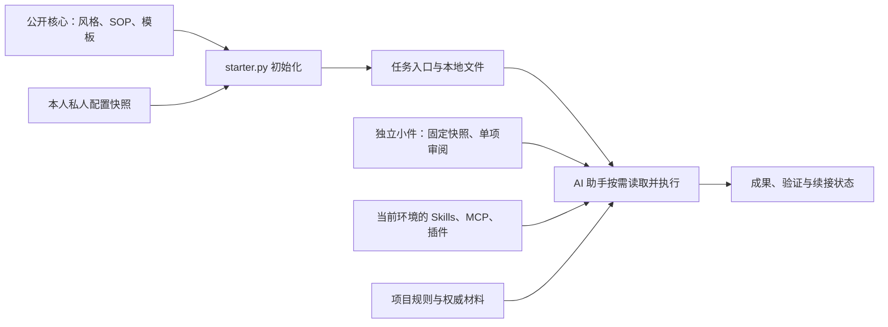

# Harness：让 AI 协作有规则、有依据、能续接

Harness 是一套本地文件式 AI 协作套件，把协作方式、任务目标、资料位置、验证与续接写成可检查的文件。
它适合调研、写作、产品规划和多步开发，尤其适合需要跨对话继续、复用已有方法的工作。
你选择的 Codex 或其他 AI 助手负责执行任务；本仓库提供通用方法、模板，以及只使用 Python 标准库的管理工具。

这套方法来自作者的个人 Harness 实践：先明确目标与完成条件，按需读取资料，用实际证据支持结论，
中断时留下下一步，有价值的经验经审阅再成为可复用方法。公开包提炼这些通用部分，个人画像和项目资料独立保存。

当前源码：**0.2.0-rc.6，尚未发布 Release 的源码候选**。需要 Python 3.11+。
最近已发布的发行包仍为 **0.2.0-rc.4**；本次更新不会覆盖该版本附件。
[下载已发布 rc.4](https://github.com/MarkTian-Long/harness-starter/releases/tag/v0.2.0-rc.4) ·
[整体架构与能力边界](docs/architecture.md) · [验证记录](docs/VALIDATION.md)

## 它能帮你做什么

| 工作中的问题 | Harness 提供的做法 | 对应文件 |
| --- | --- | --- |
| 每个新对话都要重复交代做法 | 一个短入口，按任务读取适用规则和个人调整 | `AGENTS.md`、`profile/style.md`、`private/` |
| 任务不断展开，难以判断何时完成 | 明确本次目标、权威输入、完成条件和未完成项 | `task.md`、任务推进 SOP |
| 调研结果与推断混在一起 | 核对来源、日期和直接证据，保留未知 | 研究与证据 SOP |
| 文件和成果散在多处 | 确认唯一主位置，引用成熟项目的既有入口 | 资料归位 SOP、`workspace/` |
| 中断后需要重新解释全部上下文 | 记录已有成果、证据位置和下一步 | `recovery/checkpoint.md` |
| 改动或新工具难以评估 | 明确范围、验证、依赖与恢复办法 | 变更恢复、工具采用 SOP |
| 经验积累变成大量重复规则 | 先形成小候选，经试用和审阅后更新主版本 | 收尾与经验沉淀 SOP |

例如，一次公开资料调研可以从 `task.md` 的问题与完成条件开始，按研究 SOP 整理来源，
将比较和建议放入正式成果位置；中断时留下检查点，结束时只提取有复用价值的方法候选。
这些 Markdown 是供助手执行的协作约定，Python 程序检查文件和安装状态；实际研究质量仍需验收。

## 五分钟开始

从 [最近已发布 Release](https://github.com/MarkTian-Long/harness-starter/releases/tag/v0.2.0-rc.4)
下载 `harness-starter-0.2.0-rc.4.zip`，核对附件中的 SHA-256，再解压。
在包含 `starter.py` 的目录中，用 PowerShell 初始化一个独立的空目录：

```powershell
New-Item -ItemType Directory ../my-harness
python -B starter.py init ../my-harness
python -B starter.py init ../my-harness --apply
python -B starter.py doctor ../my-harness
```

第一条 `init` 只预览，加 `--apply` 才写入。目标必须是已经存在的新空目录。
默认使用推荐模式，包含协作风格、六份按需 SOP 和续接模板。
想保留最少规则，可在两条 `init` 命令中都加 `--preset minimal`；需要检查点时再加 `--recovery`。

把生成目录交给助手，用这句话开始：

> 请先读这个目录的 AGENTS.md 和 FIRST_USE.md。帮助我把本次目标、输入和完成条件写进 task.md，再完成任务。只读取适用的 SOP；个人事实由我提供，工具权限按当前环境处理。中断时记录下一步。

第一次先选一个能验收的小任务，例如根据三份公开材料输出一页比较建议并列来源。
核对助手是否实际读取规则、结果是否准确，以及中断后能否继续。

也可从源码开始：

```powershell
git clone https://github.com/MarkTian-Long/harness-starter.git
cd harness-starter
git checkout v0.2.0-rc.4
```

任务目录放在源码或解压目录旁，避免把私人材料混入公共仓。
GitHub 自动生成的 Source code 附件是源码快照；上述带版本号的 ZIP 是经清单核对的发行包。

## 一套核心，分层保存

公开核心维护薄入口、共同边界和基础 SOP；独立小件库提供按任务选择的 Skill、SOP、模板、图样或小脚本。
每个使用者单独保存偏好与画像；任务和项目拥有自己的资料与状态。
机器路径、账号连接、Skills 和工具权限由当前运行环境管理。

| 你需要什么 | 从哪里取用 | 采用方式 |
| --- | --- | --- |
| 基础任务规则、文件生命周期、六份通用 SOP | 本仓库公开核心 | 选固定发行或源码提交，按预览初始化 |
| 某个任务需要的独立方法或小工具 | [ai-workflow-kit 导航](https://github.com/MarkTian-Long/ai-workflow-kit) | 按用途选单项；采用时固定版本/提交，保留其依赖、许可和说明 |
| 本人偏好、画像、机器或项目差异 | 自己的私人层及项目正式入口 | 独立审阅与维护，不随公开核心或小件包传递 |

本候选已核对的小件入口为 [固定快照 13db403](https://github.com/MarkTian-Long/ai-workflow-kit/tree/13db4036c359188af37693bb34684c1556da2ffb)。
`main` 用于浏览和发现更新，不作为可重复采用的版本标识。SOP 可以直接读；Skill 先按说明单项试用，
需要安装时再处理对应目录和宿主支持，不整包安装，也不因为有链接就视为已采用。
任务先查当前权威来源和已有本地方法；没有实际缺口时无需接入新小件。



| 生成的文件或目录 | 职责 |
| --- | --- |
| `AGENTS.md` | 薄入口，按任务路由到适用资料 |
| `FIRST_USE.md` | 首次选择、可修改内容和第一个真实任务 |
| `profile/style.md` | 推荐协作风格与六类分析视角；最简模式不装 |
| `standards/` | 六份按需 SOP；最简模式不装 |
| `private/overlay.md` | 使用者的协作偏好；默认是空白模板 |
| `private/profile.md` | 可选的本人背景与适用范围，需自行建立或明确导入 |
| `task.md` | 当前任务的目标、输入、完成条件和状态 |
| `workspace/`、`personal/` | 项目材料和独立个人实验的入口 |
| `recovery/checkpoint.md` | 中断时的成果、未完成项、证据位置与下一步 |
| `.starter-state.json` | 程序登记的版本、受管文件和初始摘要 |

成熟项目继续使用自己的 `AGENTS.md`、规范、计划和状态入口；正式资料在原位引用，避免另建重复台账。
推荐风格是可编辑的默认方式，不包含作者身份，也不继承作者的历史操作授权。
更多职责和数据流见 [架构说明](docs/architecture.md)，预设差异见 [模块说明](docs/modules.md)。

## 当前提供到哪一层

| 能力 | 当前状态 |
| --- | --- |
| 推荐/最简初始化、预览后写入 | 公共 `starter.py` 已提供 |
| 文件检查、续接入口、离线示例、退出保留 | 公共 `starter.py` 已提供 |
| 本人偏好与画像的显式快照导出/导入 | 公共 `starter.py` 已提供，仅处理两份私人 Markdown |
| 六份 SOP、分析视角、经验候选与审阅约定 | 公共 Markdown 已提供，由助手按需执行 |
| 按真实任务定位已有方法、单项试用及效果复核 | 现有入口与 SOP 约定；不提供自动安装或新全局登记器 |
| 作者本机的用户级入口、固定个人读层、采用集合与备份管理 | 另行部署的本机接入；公开发行包未包含该管理器 |
| 第三方 Skills、MCP、插件、模型和账号 | 沿用使用者当前环境，本仓库不捆绑实现或认证状态 |
| 双机自动同步、冲突合并、经验自动晋升、完整记忆治理系统 | 当前公共包未提供 |

作者本机可以把公共方法接到用户级入口，把已采用的偏好与画像放在 `.codex/profile/`，
让各项目继续保留自己的资料。它与本仓库的“独立任务目录”是不同的接入方式；
本机部署结构与尚待补齐的原机机制见 [架构说明](docs/architecture.md#作者本机的用户级接入)。
这里只介绍已核对的职责，不把该部署示例当作公开包已有的全局安装命令。

## 本人换电脑：导出与导入私人配置

在已初始化的目录里编辑 `private/overlay.md` 和可选的 `private/profile.md`，
从匹配版本的核心目录运行：

```powershell
python -B starter.py export-profile ../my-harness --output ../my-profile.json
python -B starter.py export-profile ../my-harness --output ../my-profile.json --apply
```

输出须是目标目录之外的新文件。它只收集上述两份 Markdown，不收集项目材料、Skills、
账号、权限、聊天或原生记忆。JSON 未加密，只通过本人信任的方式传递。

新电脑准备同一版本核心，将私人 JSON 单独放在包目录旁，再运行：

```powershell
New-Item -ItemType Directory ../my-harness
python -B starter.py init ../my-harness --profile ../my-profile.json
python -B starter.py init ../my-harness --profile ../my-profile.json --apply
python -B starter.py doctor ../my-harness
```

这是明确选择的一次快照导出/导入。两台电脑持续使用时，应审阅彼此的方法候选和偏好差异，
再分别决定采用；项目资料各自保留。程序不执行双向同步或三方合并。
导入后仍需核验事实、路径、依赖、账号与授权，详见 [迁移范围](docs/migration.md)。

## 检查、续接与退出

`doctor` 检查文件可用性、安装状态和模板差异，不判断正文正确性。
正常编辑仍可续接；缺少必需文件、损坏状态或不安全路径会失败。
`recover` 只在文件可用时提示读取任务和检查点，不恢复全部聊天。

```powershell
python -B starter.py recover ../my-harness
python -B starter.py demo ../my-harness --apply
python -B starter.py uninstall ../my-harness
python -B starter.py uninstall ../my-harness --apply
```

`demo` 的合成结果是 `count=3`、`total=10`，用于检查本地工具流程，不代表 AI 任务质量。
卸载只删除未修改的受管公共文件；私人文件、修改过的文件和未登记文件保留。
必要的 `.gitignore` 也保留，因此退出后目录可能非空。

`rollback` 是卸载的别名，不是历史版本恢复。不同发行的安装状态由匹配的旧发行管理；
本版没有原位升级器，升级时保留旧目录，在新空目录试用。
初始化不修改全局 Codex 配置，不建立服务或后台任务。

## 构建、验证与贡献

在清单一致的公共源码根目录运行：

```powershell
python -B release.py
python -B tests/acceptance.py
```

本源码候选产物为 `dist/harness-starter-0.2.0-rc.6.zip` 和带 ZIP 摘要的 `dist/release-manifest.json`；
本地构建、源码提交和 Release 附件发布分别核验，不据构建成功宣称 rc.5 已发布。
验收在源码与 ZIP 解压目录运行同一组单测，重复执行不算新增独立用例。
文档也在精确发行清单内；修改后须递增候选版本并重生内嵌清单，见 [发行与回退](docs/release.md)。

GitHub Actions 验证 Windows/Linux、Python 3.11/3.12 的公共文件与 CLI；仅验收，不自动创建 Release。
实际结果分别查看 [公开验证说明](docs/VALIDATION.md)、[Actions](https://github.com/MarkTian-Long/harness-starter/actions)
和对应 Release 附件。文件与构建通过，不证明助手自动加载、第二台物理机器可用或真实任务收益。

欢迎通过 [Issues](https://github.com/MarkTian-Long/harness-starter/issues) 提交脱敏样例，
或按 [贡献说明](CONTRIBUTING.md) 改进通用方法。个人事实留在私人配置，项目内容留在项目中。
MIT 适用于本公开范围；第三方 Skills 实现未捆绑，见 [来源说明](docs/provenance.md)。

进一步阅读：[架构说明](docs/architecture.md) · [模块说明](docs/modules.md) ·
[验证范围](docs/QA.md) · [权限与数据边界](docs/security.md) ·
[作者的个人 Harness 实践](https://marktian-long.github.io/tools/blog/posts/personal-harness.html)。
实践文章描述的完整个人体系范围更广，具体发布能力以本仓库和对应版本验证为准。
