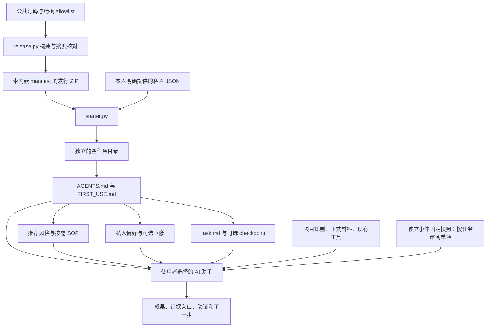
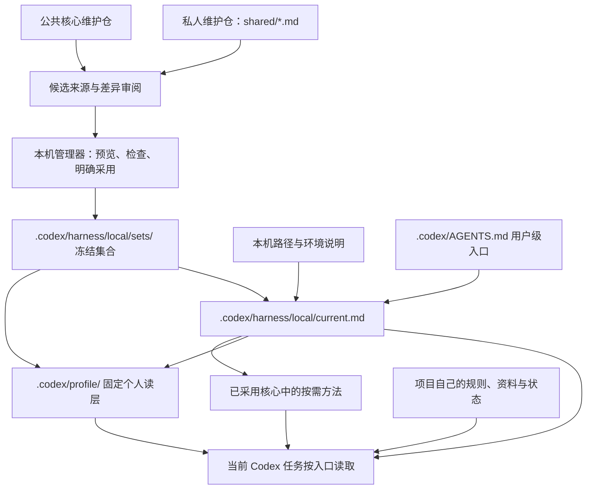

# Harness 架构与能力边界

本说明对应公共核心 **0.2.0-rc.6 源码候选**，尚未发布该版本 Release；最近已发布版本仍为 rc.4。
它同时介绍公开核心、独立小件和私人接入方式，并明确各自的实现范围。
公共包的开始步骤见 [README](../README.md#五分钟开始)，文件和预设对照见 [模块说明](modules.md)。

## 目标与基本选择

Harness 把容易在对话中丢失的信息保存为可阅读、可审阅、可续接的本地文件：协作规则、任务目标、
权威资料入口、完成条件和下一步。AI 助手读取这些文件并执行任务，工具负责检查文件生命周期。

设计上有四个选择：

1. **薄入口，按需读取。** `AGENTS.md` 路由到当前任务需要的风格、私人调整和 SOP，减少无关上下文。
2. **核心、小件、个人、机器、项目分别维护。** 核心保留共同边界和路由，独立方法按真实任务单项取用；身份和偏好由本人审阅，机器能力在本机核验，项目资料原位保存。
3. **状态保留在任务或项目中。** 目标与检查点服务于具体任务，不建一个全局任务台账，也不把聊天全文当作续接材料。
4. **程序检查与任务验收分别进行。** 文件存在、摘要一致和命令通过，支持可用性判断；研究正确、助手实际读取规则和长期收益需要另行验证。

### 核心、小件库与私有层的衔接

核心负责基础协作规则、路由和文件生命周期；[ai-workflow-kit](https://github.com/MarkTian-Long/ai-workflow-kit)
负责可单独取用的 Skill、SOP、模板、图样与脚本。两者各有固定来源与发布清单；小件库不依赖整套核心，
核心初始化也不把小件库整包安装。本人偏好、画像、机器配置及项目事实留在其正式私有位置。

本候选核对的可重复采用入口是 [13db403 固定快照](https://github.com/MarkTian-Long/ai-workflow-kit/tree/13db4036c359188af37693bb34684c1556da2ffb)。
仓库 main 只作导航；实际使用记录所选小件的提交、适用条件和依赖。先找本地已采用的权威方法，
有缺口才取新项；按任务完成最小实际调用，并分开判断找到、用对、有帮助及值得维护。
记录留在已有任务/依赖说明，不另建平行注册表；没有收益或维护成本上升时收窄、合并或退出。
公开修订回到该资产唯一编辑源后再导出下一快照，不把安装副本和发布副本都变成手工主源。

## 公共发行包的组成



`starter.py` 仅使用 Python 标准库；没有网络调用、模型调用或后台工作进程。
`release.py` 按精确源码清单构建确定性 ZIP。GitHub Actions 运行验收，Release 由维护者另行发布。

### 目录与职责

以下是推荐模式的生成结构，`private/profile.md` 需自行建立或明确导入：

```text
my-harness/
├── AGENTS.md
├── FIRST_USE.md
├── task.md
├── .starter-state.json
├── .gitignore
├── profile/style.md
├── standards/
│   ├── task-flow.md
│   ├── storage.md
│   ├── research-evidence.md
│   ├── change-recovery.md
│   ├── tool-adoption.md
│   └── closeout.md
├── private/
│   ├── overlay.md
│   └── profile.md                 # 可选
├── workspace/README.md
├── personal/README.md
└── recovery/checkpoint.md
```

| 层 | 编辑与读取方式 | 职责和边界 |
| --- | --- | --- |
| 公共方法 | 在核心源码维护，实例中按需读取 | 默认风格、分析视角和通用 SOP；不含作者身份、历史授权 |
| 独立小件 | 单项来源维护，固定版本取用 | 可直接读的 SOP、模板或需单独验证的 Skill/脚本；不随核心自动安装 |
| 私人调整 | 本人编辑 `private/`；明确导出/导入 | 表达偏好、愿意提供的背景、适用范围；不代替账号或权限核验 |
| 任务状态 | 当前任务维护 `task.md` 和检查点 | 成果、未完成项、证据入口与下一步；不复制所有聊天 |
| 项目材料 | 项目自己的正式入口维护 | 已有规则、业务材料、成果和状态，不随私人配置迁移 |
| 机器与运行环境 | 在使用者当前电脑独立管理 | 模型、Skills、MCP、插件、依赖、账号连接、权限与路径 |
| 安装登记 | 程序生成 `.starter-state.json` | 版本、预设、模块、受管文件初始摘要与私人文件声明 |

`workspace/` 和 `personal/` 提供资料组织入口；成熟项目继续维护自己的正式位置。
最简模式省去推荐风格、六份 SOP 和默认检查点；使用 `--recovery` 可单独加检查点。
生成目录中的 `.gitignore` 是私人文件忽略约定，不是加密或访问控制。

### 六份 SOP 如何参与任务

| 方法 | 触发场景 | 主要输出或作用 |
| --- | --- | --- |
| [任务推进](../templates/standards/task-flow.md) | 多步执行、中断或交接 | 明确目标、依赖、完成条件和下一步 |
| [资料归位](../templates/standards/storage.md) | 保存、移动、整理资料 | 确认唯一主位置，维护入口和引用 |
| [研究与证据](../templates/standards/research-evidence.md) | 调研、比较、事实冲突 | 核对来源与日期，区分直接证据、推断和未知 |
| [变更恢复](../templates/standards/change-recovery.md) | 修改文件、规则、工具或配置 | 控制范围，选择适当验证，保留恢复依据 |
| [工具采用](../templates/standards/tool-adoption.md) | 定位复用方法或评估/连接工具 | 先已有源，再核对固定版本、依赖、授权、真实调用和退出 |
| [收尾沉淀](../templates/standards/closeout.md) | 实质任务结束、交接或反复摩擦 | 验收结果，形成小候选，经审阅再更新主版本 |

SOP 是给助手读取的操作方法，不是 Python 自动执行的服务。
分析视角见 [默认风格](../templates/profile/style.md)：按问题选择会改变判断的少数视角，简单任务不用逐项展开。

## 文件生命周期与数据流

| 命令 | 实际行为 |
| --- | --- |
| `init` | 检查专用空目录；预览所选模板，`--apply` 创建文件和安装状态 |
| `doctor` | 核对版本与状态结构、必需文件和模板差异；正常编辑可保持可用 |
| `recover` | 文件可用时提示读取 `task.md` 与已安装的检查点 |
| `demo` | 运行固定合成样例；`--apply` 创建示例文件，不覆盖已有输出 |
| `export-profile` | 只读取 `private/overlay.md` 与可选的 `private/profile.md`，导出到目标目录外的新 JSON |
| `uninstall` / `rollback` | 预览或删除未修改的受管公共文件；保留私人、修改过和未登记文件 |

路径检查拒绝设备别名、不安全路径以及不支持的链接形式；它保护上述文件操作，不能作为 AI 助手或外部工具的系统沙箱。
状态版本必须匹配运行脚本；`rollback` 只是卸载别名。跨版本试用应新建目录并保留旧发行，详见 [发行与回退](release.md)。

一次典型任务的数据流是：

1. 助手读取任务入口，核对用户当前目标、项目规则、权威输入和完成条件。
2. 读取适用的风格、私人调整及少数 SOP；实质任务交付前定位已有可复用方法，先核对权威主源。有真实缺口才按固定版本单项取用新小件，调用当前环境中已获授权的工具。
3. 在项目正式位置维护成果与必要证据；中断或交接时更新唯一任务状态和下一步。
4. 完成后验收实际结果。有复用价值时形成方法候选，保留来源、适用范围、最小验证和退出条件。
5. 审阅后更新对应唯一主版本：共同规则进入核心，独立方法进入所属小件，个人调整留在私人资料，项目约定留在项目中。发布、安装和正式采用分别验证，不平行手改各副本。

第 4、5 步已有方法约定，公共程序没有自动发现、写入或晋升经验的执行引擎。

## 作者本机的用户级接入

作者当前 Windows 电脑在公共核心之外部署了用户级接入。以下使用通用相对路径描述其已采用结构；
**本仓库和发行 ZIP 不包含该本机管理器，不提供对应的一键部署命令。**
公共 `starter.py` 管理独立任务目录；本机管理器管理用户级规则的采用集合，两者命令与状态不能混用。



这里的“根目录个人层”是用户配置根目录 `.codex/` 下的固定 `profile/`，不是磁盘根目录或所有项目的根目录。

| 位置 | 当前职责 |
| --- | --- |
| `.codex/AGENTS.md` | 用户级薄入口，指向当前采用说明 |
| `.codex/profile/CORE_PROFILE.md` | 与任务相关时读取的本人背景 |
| `.codex/profile/preferences.md` | 短协作偏好 |
| `.codex/profile/scope.md` | 个人资料的适用范围与复核边界 |
| `.codex/profile/analysis-lenses.md` | 复杂判断按需读取的分析视角 |
| `.codex/profile/experience-flow.md` | 经验候选、审阅与回流约定 |
| `.codex/profile/README.md`、`profile-manifest.json` | 个人层维护说明与来源、摘要登记 |
| `.codex/harness/local/` | 管理器、当前入口、机器说明、冻结集合和备份 |
| 私人维护仓 `shared/*.md` | 共享偏好与画像的唯一长期编辑源 |
| 各项目目录 | 各自的规则、资料、任务状态、检查点和正式成果 |

本机管理器生成固定读层、核对受管内容，并在采用或恢复时保护后续手工修改。
Git 拉取只更新候选来源；明确采用后才改变本机入口。直接编辑固定读层会产生差异，应先在主版本审阅，避免建立第二份长期编辑源。
源码仓的新版本发布也不会自动替换当前采用集合。

此接入已做过文件采用、备份及恢复相关检查，但这类检查不证明全新助手会话自动加载，也不证明第二台物理电脑可用。
现有 Skills、MCP、插件和原生记忆沿用原入口；Harness 不复制认证状态或把项目内容写入全局任务文件。

## 两台电脑如何共同演进

公共包当前提供私人配置的显式快照导出/导入；作者采用的持续演进原则是：

- 通用方法共享公共核心，个人偏好与画像共享经审阅的私人 Markdown；机器说明与项目资料各自维护。
- 每台机器的新增经验先形成候选，记录来源、触发场景、适用范围和验证；一次性例外不直接改长期事实。
- 对已有共同版本的差异进行审阅，需要时做三方比较；保留有场景依据的差异，避免无依据的整包覆盖。
- 更新共享主版本后，两台机器分别检查依赖与兼容性，并明确采用；保留原集合与恢复依据。

这是一套审阅与采用流程，不是已经交付的自动同步或自动合并服务。
另一台电脑的分析、完整 Skill 资源和真实调用证据返回后，再评估哪些能力进入公共核心、私人层或仅留本机。

## 已有能力与后续补齐边界

| 内容 | 当前实现位置或状态 |
| --- | --- |
| 通用方法、分析视角、任务与续接模板 | 公共包已提供 |
| 推荐/最简预设、私人快照往返、文件生命周期检查 | 公共 Python 工具已提供 |
| 固定用户个人层、冻结采用集合、受保护的恢复流程 | 作者本机另行部署，未纳入公共发行 |
| 经验来源、适用范围、验证和审阅 | SOP 与私人维护流程约定，由助手和使用者执行 |
| 旧机自有 Skills、检查脚本及配套依赖 | 不在公共包中；需取得完整资源、来源与调用证据再评估 |
| 完整证据台账、自动经验晋升、上下文/模型预算、工具登记与退役执行 | 当前公开实现未提供；待另一台资料核对后决定是否补齐 |
| 双机后台同步、账号迁移、全局自动安装、原位升级 | 当前公开实现未提供 |

[作者实践文章](https://marktian-long.github.io/tools/blog/posts/personal-harness.html) 描述了范围更广的个人体系。
文章中的机制、同名文件或工具描述，不能直接证明已经进入本公共版本。

当前可复现的验证重点是文件生命周期、私人往返、清单一致与确定性构建。
验证环境与结果见 [公开验证说明](VALIDATION.md)，覆盖范围见 [QA](QA.md)，数据和授权边界见 [安全说明](security.md)。
